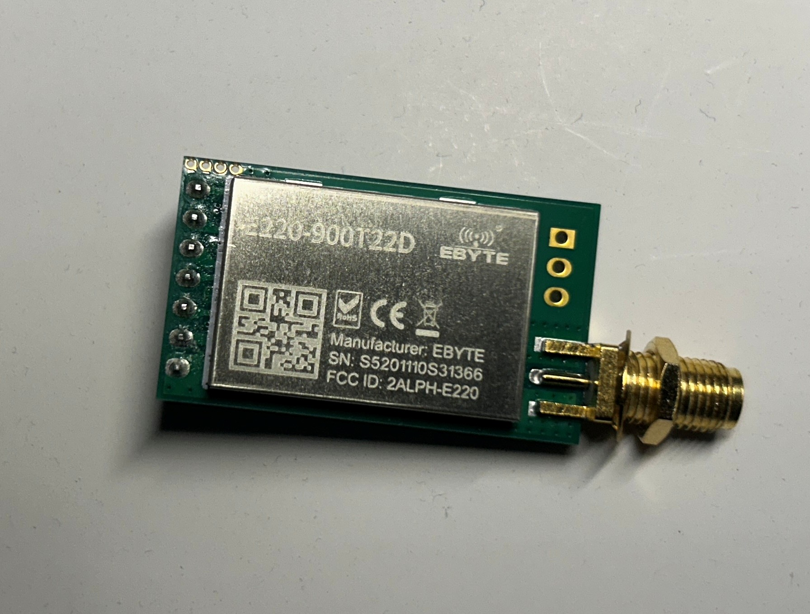
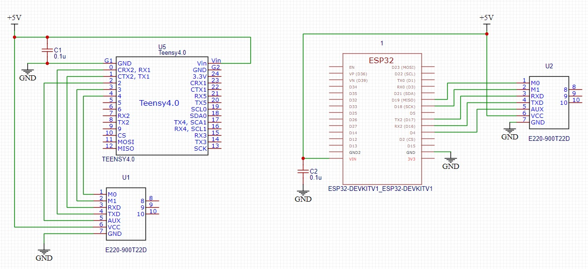

# EBYTE-E220

An Arduino library for the **EBYTE E220** series of LoRa transceivers that use a UART (serial) interface. These modules use the Semtech LLCC68 chip.



| Model          | Frequency range        | Max power |
|----------------|------------------------|-----------|
| E220-400T22D/S | 410.125 – 493.125 MHz  | 22 dBm    |
| E220-400T30D/S | 410.125 – 493.125 MHz  | 30 dBm    |
| E220-900T22D/S | 850.125 – 930.125 MHz  | 22 dBm    |
| E220-900T30D/S | 850.125 – 930.125 MHz  | 30 dBm    |

## Features

- Switch between all four operating modes (normal, WOR transmit, WOR receive, configuration/deep sleep)
- Read and write every configuration register, either **permanently** (`C0`, saved to flash) or **temporarily** (`C2`, lost at power off)
- Read the product information block (`0x80`–`0x86`)
- Read the hardware model name and firmware version with AT commands (`AT+DEVTYPE=?`, `AT+FWCODE=?`)
- Restore factory defaults
- Send in transparent mode, fixed mode (to an address and channel), or broadcast mode
- Receive whole packets, and strip the RSSI byte the module can add to each packet
- Built-in send and receive methods that move text or binary data (including structs) between different MCUs, with no external libraries needed
- Read the ambient noise RSSI and the last-packet RSSI with the `C0 C1 C2 C3` command
- Send remote (wireless) configuration commands (`CF CF …`)
- Wait on the AUX pin, or use timed delays if AUX is not connected
- Callback that re-opens the host serial port when the baud rate has to change
- Works with any `Stream`: `HardwareSerial`, `SoftwareSerial`, and others

## Installation

Download the library from [github.com/KrisKasprzak/EBYTE-E220](https://github.com/KrisKasprzak/EBYTE-E220) (**Code → Download ZIP**). Then either copy the `EBYTE-E220` folder into your Arduino `libraries` folder, or use **Sketch → Include Library → Add .ZIP Library…**. Restart the IDE afterwards.

```
EBYTE-E220/
├── src/EBYTE-E220.h
├── src/EBYTE-E220.cpp
├── examples/E220-Send/E220-Send.ino
├── examples/E220-Receive/E220-Receive.ino
├── examples/E220-SimpleSend/E220-SimpleSend.ino
├── examples/E220-SimpleReceive/E220-SimpleReceive.ino
├── Images/
├── keywords.txt
├── library.properties
├── LICENSE
└── README.md
```

## Wiring

| E220 pin | Connect to                    | Notes                                         |
|----------|-------------------------------|-----------------------------------------------|
| M0       | MCU digital output            | Mode select                                   |
| M1       | MCU digital output            | Mode select                                   |
| RXD      | MCU TX                        | 3.3 V logic. Use a level shifter on 5 V boards |
| TXD      | MCU RX                        |                                               |
| AUX      | MCU digital input             | LOW = busy, HIGH = idle. Optional but recommended |
| VCC      | 3.3 – 5.5 V                   | 30 dBm modules need a supply that can deliver high current peaks |
| GND      | GND                           |                                               |

The test setup: a Teensy 4.0 (left) and an ESP32 DevKit V1 (right), each wired to an E220-900T22D module powered from 5 V with a 0.1 µF decoupling capacitor.



| Mode | M1 | M0 | Enum                 | Description                                      |
|------|----|----|----------------------|--------------------------------------------------|
| 0    | 0  | 0  | `E220_MODE_NORMAL`   | Normal send and receive                          |
| 1    | 0  | 1  | `E220_MODE_WOR_TX`   | Sends with a wake-up preamble                    |
| 2    | 1  | 0  | `E220_MODE_WOR_RX`   | Low-power receive (wake on radio)                |
| 3    | 1  | 1  | `E220_MODE_CONFIG`   | Configuration / deep sleep (UART fixed at 9600 8N1) |

## Quick start

These two sketches go together. The sender, at address `0x0001`, sends "Hello" every 5 seconds to the receiver at address `0x0002`. Both use channel 18 in fixed transmission mode.

### Sender

```cpp
#include <EBYTE-E220.h>

EBYTE_E220_UART radio(&Serial1, /*M0*/ 7, /*M1*/ 6, /*AUX*/ 5, E220_MODEL_900T22);

void setup() {
    Serial.begin(115200);
    Serial1.begin(9600);

    if (radio.begin() != E220_SUCCESS) {      // also reads the current settings
        Serial.println("E220 not found");
    }

    radio.setAddress(0x0001);
    radio.setChannel(18);                      // 850.125 + 18 = 868.125 MHz
    radio.setAirDataRate(E220_AIR_2K4);
    radio.setTransmissionMethod(E220_TX_FIXED);
    radio.setAmbientRSSIEnabled(true);
    radio.saveParameters(E220_SAVE_PERMANENT); // or E220_SAVE_TEMPORARY

    radio.printParameters(Serial);
}

void loop() {
    radio.sendFixedMessage(0x0002, 18, "Hello");
    delay(5000);
}
```

### Receiver

```cpp
#include <EBYTE-E220.h>

EBYTE_E220_UART radio(&Serial1, /*M0*/ 7, /*M1*/ 6, /*AUX*/ 5, E220_MODEL_900T22);

uint8_t rxBuffer[E220_MAX_PACKET_SIZE + 1];    // +1 for the string terminator

void setup() {
    Serial.begin(115200);
    Serial1.begin(9600);

    if (radio.begin() != E220_SUCCESS) {      // also reads the current settings
        Serial.println("E220 not found");
    }

    radio.setAddress(0x0002);                  // the address the sender sends to
    radio.setChannel(18);                      // must match the sender
    radio.setAirDataRate(E220_AIR_2K4);        // must match the sender
    radio.setTransmissionMethod(E220_TX_FIXED);
    radio.setPacketRSSIEnabled(true);          // module adds an RSSI byte to each packet
    radio.saveParameters(E220_SAVE_PERMANENT); // or E220_SAVE_TEMPORARY

    radio.printParameters(Serial);
}

void loop() {
    if (radio.available()) {
        uint16_t rxLength = radio.receiveMessage(rxBuffer, E220_MAX_PACKET_SIZE);
        if (rxLength > 0) {
            rxBuffer[rxLength] = '\0';         // received text is not null-terminated
            Serial.print("Received: ");
            Serial.print((char*)rxBuffer);
            Serial.print("  RSSI: ");
            Serial.print(radio.getReceivedPacketRSSI());   // RSSI byte already removed from rxBuffer
            Serial.println(" dBm");
        }
    }
}
```

## Programming the module

The setters only change a copy of the registers held in the library. Call `saveParameters()` to write them to the module. The library switches to configuration mode, sends the command, checks the reply, and returns to the mode you were in.

```cpp
radio.readParameters();                     // load the module's registers into the library copy
radio.setChannel(23);
radio.setTransmitPower(E220_POWER_HIGH);
radio.saveParameters(E220_SAVE_TEMPORARY);  // applied now, not kept after power off
```

### Baud rate changes

In configuration mode the module only talks at **9600 8N1**. If you set a different UART baud rate or parity, register a callback. The library calls it to re-open the host serial port when it enters and leaves configuration mode. It is only called when the baud rate or parity actually changes:

```cpp
void openSerialPort(uint32_t baudRate, uint8_t parityMode) {   // parityMode: E220_Parity value
    Serial1.end();             // omit on Teensy 3.x - end() makes the next received byte get lost
    Serial1.begin(baudRate);   // map parityMode to SERIAL_8O1 / SERIAL_8E1 if needed
}
...
Serial1.begin(9600);
radio.setSerialConfigCallback(openSerialPort);   // assumes the port is open at 9600 8N1
// radio.setSerialConfigCallback(openSerialPort, 115200, E220_PARITY_8N1);  // if opened otherwise
```

## RSSI

There are two ways to get signal strength. Both give values in dBm, worked out as `-(256 - raw)`.

1. **RSSI byte added to each packet**: call `setPacketRSSIEnabled(true)` on the receiver. `receiveMessage()` removes this byte from the data, and `getReceivedPacketRSSI()` returns it.
2. **RSSI register command**: call `setAmbientRSSIEnabled(true)`. Then, in normal or WOR-transmit mode, use:
   - `getAmbientRSSI(&dbm)`: current channel noise
   - `getLastPacketRSSI(&dbm)`: RSSI of the last packet received
   - `getRSSI(&noiseDbm, &packetDbm)`: both values in one call

> The register command sends its reply on the same UART as received data. Before sending the command, the library waits for the module to finish its output and discards anything left. It then searches for the reply header and reads the whole reply, so the reply can never end up mixed into the next packet. Radio data that arrives during an RSSI query is discarded, so read RSSI only after you have handled any pending packets. When you send binary structs, include a sync word and checksum, as the examples do.

## API reference

### Setup and mode

| Method | Description |
|--------|-------------|
| `EBYTE_E220_UART(Stream*, m0, m1, aux = -1, model = E220_MODEL_900T22)` | Constructor. Pass `aux = -1` if AUX is not connected |
| `uint8_t begin()` | Sets up the pins, waits for the module, and reads its settings |
| `setSerialConfigCallback(cb, baud = 9600, parity = 8N1)` | Callback that re-opens the host serial port at a new baud rate. `baud`/`parity` say how the port is currently open |
| `setModel(model)` / `getModel()` | Module model. Sets the frequency base, channel range, and power table |
| `setMode(mode)` / `getMode()` | Change or read the operating mode |
| `isBusy()` | `true` while AUX is LOW |
| `waitForAux(timeoutMs)` | Blocks until AUX is HIGH |

### Programming

| Method | Description |
|--------|-------------|
| `readParameters()` | Reads registers `00h`–`05h` into the library copy |
| `saveParameters(saveType)` | Writes the library copy to the module. Also writes the encryption key if one was set |
| `restoreDefaults(saveType)` | Writes the factory default settings |
| `readProductInfo(buf[7])` | Reads the product information block |
| `char* readHardwareModel()` | Asks the module for its model name with `AT+DEVTYPE=?` and returns it without the `DEVTYPE=` prefix, e.g. `E220-900T22D`. Returns `NULL` if the reply does not start with `E220` |
| `char* readVersion()` | Asks the module for its firmware version with `AT+FWCODE=?` and returns it without the `FWCODE=` prefix. Returns `NULL` if there is no reply; the contents are not checked |
| `readRegisters(start, buf, len)` | Reads registers directly (up to 8) |
| `writeRegisters(start, buf, len, saveType)` | Writes registers directly (up to 8) |

### Settings (library copy; call `saveParameters()` to apply)

| Setting | Setter / Getter | Values |
|---------|-----------------|--------|
| Address | `setAddress(u16)`, `setAddressHigh`, `setAddressLow` / `getAddress…` | `0x0000`–`0xFFFF` (`0xFFFF` = broadcast/monitor) |
| Channel | `setChannel(ch)` / `getChannel()`, `getMaxChannel()`, `getFrequency()` | 0–83 (400 MHz models), 0–80 (900 MHz models) |
| UART baud | `setUARTBaudRate` / `getUARTBaudRate`, `getUARTBaudRateValue` | `E220_UART_1200` … `E220_UART_115200` |
| Parity | `setParity` / `getParity` | `E220_PARITY_8N1`, `8O1`, `8E1` |
| Air data rate | `setAirDataRate` / `getAirDataRate`, `getAirDataRateValue` | `E220_AIR_2K4` … `E220_AIR_62K5` |
| Sub packet | `setSubPacketSize` / `getSubPacketSize`, `getSubPacketSizeValue` | 200 / 128 / 64 / 32 bytes |
| Ambient RSSI | `setAmbientRSSIEnabled` / `getAmbientRSSIEnabled` | bool |
| TX power | `setTransmitPower` / `getTransmitPower`, `getTransmitPowerDbm` | `E220_POWER_MAX`, `HIGH`, `MEDIUM`, `LOW` |
| Packet RSSI byte | `setPacketRSSIEnabled` / `getPacketRSSIEnabled` | bool |
| Transmission | `setTransmissionMethod` / `getTransmissionMethod` | `E220_TX_TRANSPARENT`, `E220_TX_FIXED` |
| LBT | `setLBTEnabled` / `getLBTEnabled` | bool (listen before talk) |
| WOR cycle | `setWORCycle` / `getWORCycle`, `getWORCycleMs` | `E220_WOR_500MS` … `E220_WOR_4000MS` |
| Encryption key | `setEncryptionKey(u16)` | Write-only. Must be the same on both ends |

### Send and receive

| Method | Description |
|--------|-------------|
| `sendMessage(buf, len)` / `sendMessage(text)` | Transparent send. The receiver needs the same address and channel |
| `sendFixedMessage(addr, ch, buf, len)` / `(addr, ch, text)` | Fixed send. Requires `E220_TX_FIXED` |
| `sendBroadcastMessage(ch, buf, len)` / `(ch, text)` | Fixed send to `0xFFFF` (every module on that channel) |
| `available()` / `read()` | Direct access to the serial stream |
| `receiveMessage(buf, maxLen, timeoutMs)` | Reads one packet (ends when the line goes quiet) and returns the data length |
| `getReceivedPacketRSSI()` | RSSI from the last packet's RSSI byte (dBm) |
| `getAmbientRSSI`, `getLastPacketRSSI`, `getRSSI` | RSSI register commands |
| `sendRemoteConfig(cmd, start, buf, len, resp, respSize, &respLen)` | Wireless configuration (`CF CF`). See the E220 user manual for what the target module needs |

### Diagnostics

| Method | Description |
|--------|-------------|
| `printParameters(Print&)` | Prints all settings in readable form |
| `EBYTE_E220_UART::statusToString(status)` | Converts a status code (`E220_Status` value) to text |

Status results, enum-valued parameters, and enum-valued getters are plain `uint8_t`. Compare them with the enum constants, e.g. `if (radio.begin() != E220_SUCCESS)` or `if (radio.getParity() == E220_PARITY_8E1)`. Most methods return one of the `E220_Status` values: `E220_SUCCESS`, `E220_ERR_TIMEOUT`, `E220_ERR_AUX_TIMEOUT`, `E220_ERR_INVALID_PARAM`, `E220_ERR_FORMAT` (module replied `FF FF FF`), `E220_ERR_BAD_RESPONSE`, `E220_ERR_WRONG_MODE`, `E220_ERR_NOT_ENABLED`, or `E220_ERR_NOT_INITIALIZED`.

## Examples

- **E220_Send**: programs address `0x0001`, channel 18, fixed transmission, and ambient RSSI. Prints the product info, then every 5 s reads the channel noise and sends a `SensorPacket` struct (`uint32_t`, `float`, `float`, `int32_t`, plus a sync word and checksum) filled with dummy data to `0x0002`.
- **E220_Receive**: programs address `0x0002`, channel 18, fixed transmission, ambient RSSI, and the packet RSSI byte. Copies each received packet back into the `SensorPacket` struct, rejects it if the sync word or checksum is wrong, and prints its fields with the RSSI from both the packet byte and the register command, and reports idle noise every 10 s.

Both examples use `SoftwareSerial` on AVR boards, `Serial2` on ESP32, and `Serial1` on other boards. They were compiled for Arduino Uno, ESP32, and Teensy 4.0.

For 400 MHz modules, set `MODULE_MODEL` to `E220_MODEL_400T22` or `E220_MODEL_400T30`, and pick a channel such as 23 (433.125 MHz).

## Sending data between different MCUs

The library's own send and receive methods are all you need to exchange data between different microcontrollers. You don't need any other library for packet framing, serialization, or radio handling. The sending MCU calls `sendMessage()`, `sendFixedMessage()`, or `sendBroadcastMessage()` with a text string or a byte buffer. The receiving MCU calls `receiveMessage()` to get the whole packet back.

To send binary data such as a struct, follow the pattern in the examples so both sides see the same bytes:

- Declare the struct `__attribute__((packed))` so the compiler adds no padding.
- Use fixed-width types (`uint8_t`, `int16_t`, `uint32_t`, `int32_t`, `float`). Avoid plain `int`, `long`, and `double`, because their size differs between AVR and 32-bit MCUs.
- Add a sync word and a checksum so the receiver can reject foreign or corrupted packets.
- Keep the struct no larger than the sub packet size (200 bytes by default).

## Tested hardware

Communication between modules has been tested with these board pairs:

| Sender ↔ Receiver | Result |
|-------------------|--------|
| Teensy 4.0 ↔ Teensy 4.0 | Working |
| Teensy 4.0 ↔ ESP32 | Working |

## Notes

- `E220_SAVE_PERMANENT` writes to flash. When testing, or changing settings often, use `E220_SAVE_TEMPORARY`.
- Messages can be at most one sub packet long (200 bytes by default).
- In fixed mode the module removes the 3-byte address header, so the receiver gets only the data.
- `readHardwareModel()` and `readVersion()` switch to configuration mode, wait up to 1 s for the reply line, and then return to the previous mode. The returned pointer points into a buffer inside the library that the next call overwrites, so copy the string if you need to keep it.
- Without the AUX pin the library uses fixed and estimated delays, which is slower and less reliable.

## License

MIT. See [LICENSE](LICENSE) and the header of `src/EBYTE-E220.h`.
